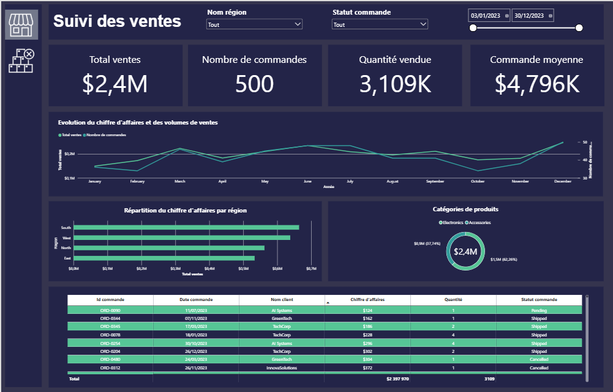
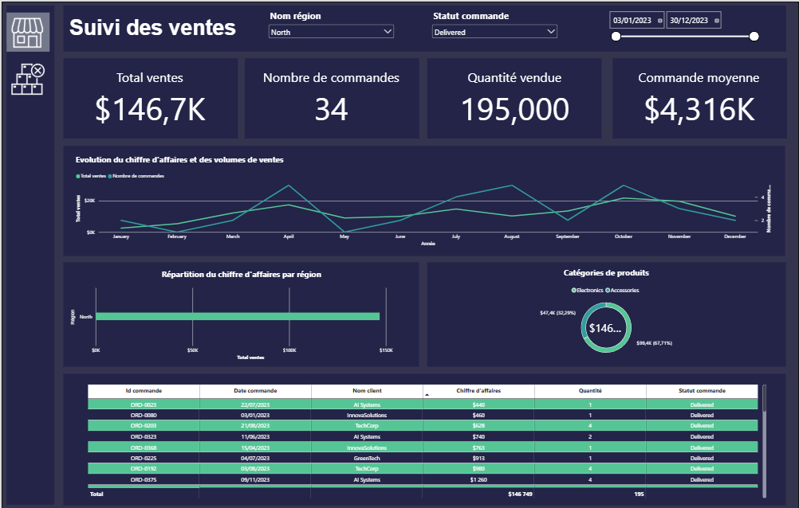
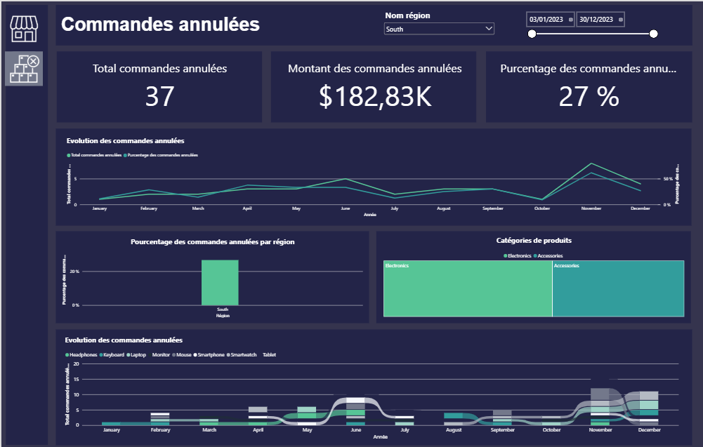
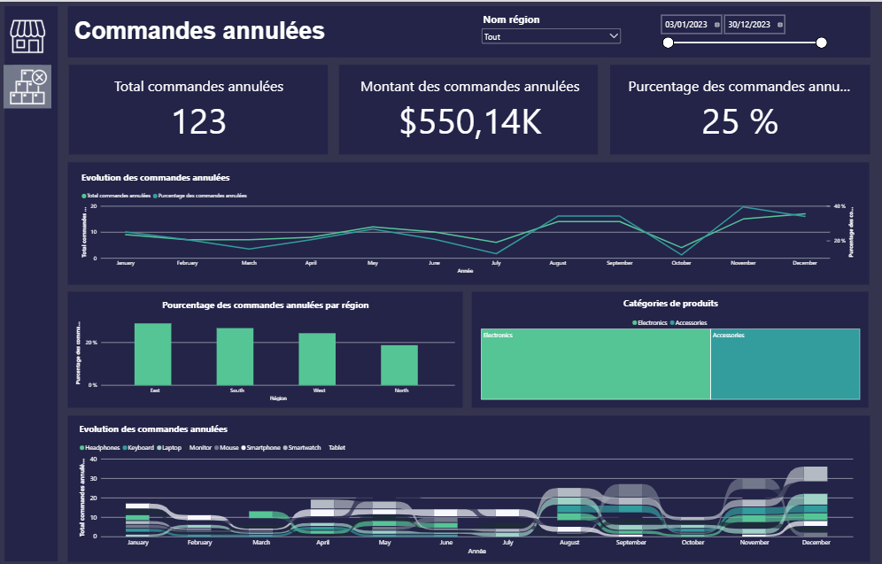

# 📊 Sales & Cancelled Orders Analytics Dashboard (Power BI)

## 📖 Project Overview
This project features an interactive Power BI dashboard designed to monitor sales performance and analyze the root causes and patterns of cancelled orders. The goal is to provide business stakeholders with actionable insights to optimize revenue and reduce order cancellations.

## 🖼️ Dashboard Preview

### 1. Sales Tracking Dashboard
*Global view of sales performance, revenue trends, and top categories.*

*Filtered view by Region (North) and Order Status (Delivered).*

### 2. Cancelled Orders Dashboard
*Analysis of cancellation rates, lost revenue, and regional impact.*

*Focus on the South region, showing a 27% cancellation rate.*

## 🎯 Key Insights & Features

Based on the interactive dashboard, the following insights can be extracted:

**Sales Performance (Suivi des ventes):**
*   **Total Revenue:** $2.4M generated from 500 orders.
*   **Average Order Value:** $4,796K.
*   **Top Region:** The **South** region generates the highest revenue, followed by the West.
*   **Product Categories:** Electronics is the dominant category, accounting for **57.97%** of sales ($1.5M), while Accessories make up 42.02%.

**Cancelled Orders (Commandes annulées):**
*   **Cancellation Rate:** A global cancellation rate of **25%** was identified, representing a significant lost revenue of **$182.83K** (123 cancelled orders).
*   **Regional Disparity:** The **South** region shows a higher cancellation percentage (27%) compared to the global average, making it a priority area for operational review.
*   **Temporal Trends:** Cancellations spike during specific months (e.g., November), suggesting potential seasonal issues with inventory or logistics.

## 🛠️ Technical Stack
*   **Tool:** Microsoft Power BI Desktop
*   **Data Transformation:** Power Query (ETL)
*   **Calculations:** DAX (Data Analysis Expressions) for dynamic measures (Total Sales, % Cancelled, etc.)
*   **Data Modeling:** Star Schema approach for optimal performance.

## 📂 Repository Structure
*   `Dataset/`: Contains the raw data files (CSV/Excel).
*   `Dashboard/`: Contains the `.pbix` Power BI file.
*   `Images/`: Contains screenshots used in this README.

## 🚀 How to Use
1. Clone this repository to your local machine.
2. Open the `.pbix` file located in the `Dashboard/` folder using Power BI Desktop.
3. If prompted, update the data source path to point to the files in your local `Dataset/` folder.
4. Explore the interactive filters (Region, Order Status, Date Range) to uncover insights.
